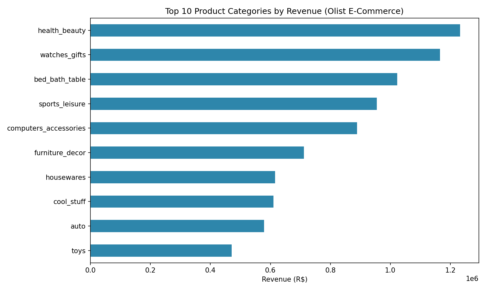
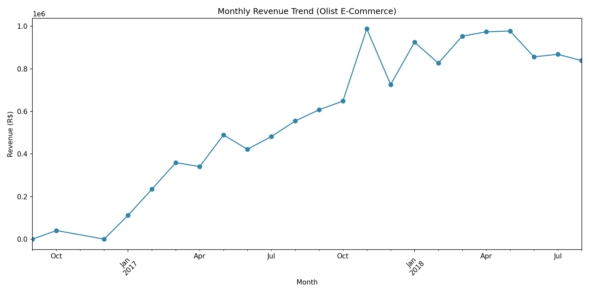

# 🛍️ Retail Sales & Delivery Performance Analysis

Analysis of 99K+ orders from a real Brazilian e-commerce marketplace (Olist) to uncover revenue drivers and delivery performance issues — using **Python, Pandas, and Matplotlib**, with an interactive dashboard in **Tableau**.

## 📊 Business Questions
- Which product categories generate the most revenue?
- How reliable is our delivery performance — what % of orders arrive late?
- How has monthly revenue trended over time?

## 🔍 Key Findings

**1. Top revenue categories**
Health & Beauty leads at ₹1.23M+ in revenue, followed by Watches & Gifts and Bed/Bath/Table — together the top 3 categories account for a significant share of total sales.

**2. Delivery performance**
6.8% of orders were delivered late, with an average delay of 10.6 days when late. Interestingly, the median order arrives 12 days *earlier* than the estimated delivery date — suggesting delivery estimates may be overly conservative, which could be tightened to improve customer experience expectations.

**3. Monthly revenue trend**
Revenue shows consistent month-over-month growth from late 2016 through 2018, with a sharp spike in November 2017 (likely Black Friday), followed by stabilization at a higher baseline.

## 🛠️ Tools Used
- **Python** (Pandas) — data cleaning, merging, aggregation
- **Matplotlib** — visualization
- **Tableau Public** — interactive dashboard *(coming soon)*

## 📁 Files
- `retail_sales_analysis.ipynb` — full analysis notebook
- `top_categories_revenue.png` / `monthly_revenue_trend.png` — chart exports

## 📌 Data Source
[Brazilian E-Commerce Public Dataset by Olist](https://www.kaggle.com/datasets/olistbr/brazilian-ecommerce) (Kaggle)
